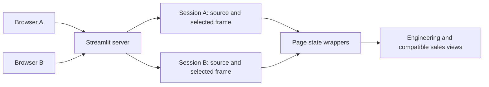
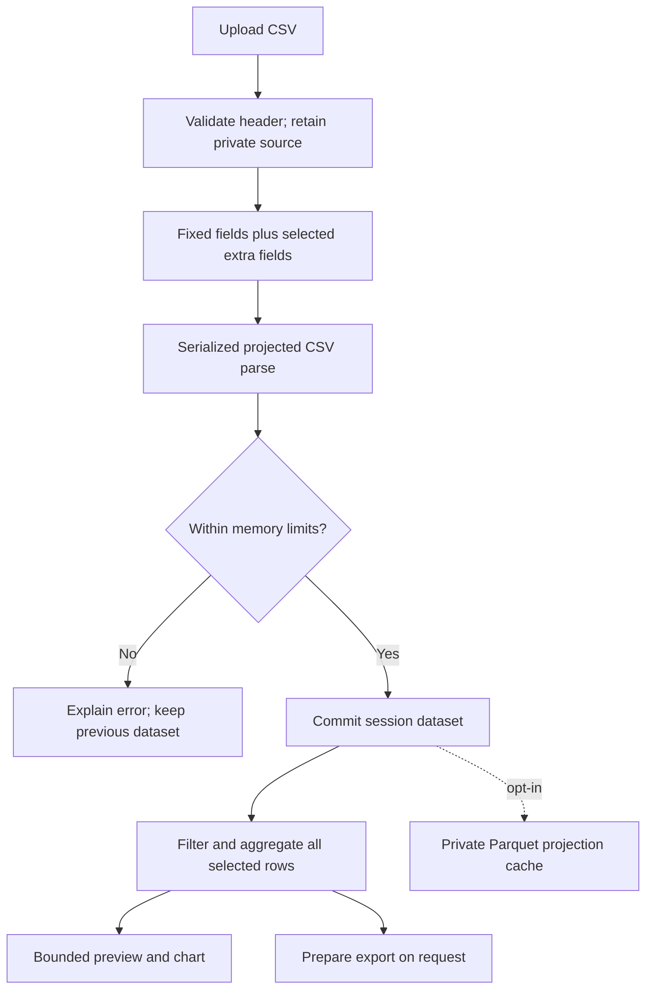

# Engineering data dashboard: service and large CSV extension

Run one Streamlit server and open it from multiple computers over a trusted LAN or VPN. Each browser tab has a separate dataset and independent page settings. The existing sales and stacked-value pages remain available, alongside a schema-independent Engineering Explorer.

## Capabilities

| Capability | Behavior |
|---|---|
| Upload | Drag a CSV from Finder/File Explorer onto the highlighted drop zone, or use its Upload button; the selected filename is shown before column selection |
| Fixed fields | All 29 fixed fields from `synthetic_sales_data.csv`, including four timeline-driven power states, when present |
| Time projection | Inclusive `Seconds` interval selected before **Apply columns**, when numeric Seconds data is available |
| Extra fields | Searchable multiselect, committed with **Apply columns** |
| Data retention | Private source file and selected pandas projection per session |
| Navigation | Data, shared sales filters, and page-specific selections survive page switches |
| Engineering views | Categorical/numeric filters, grouping, aggregation, full/stacked tables, numeric/datetime trends |
| Sales pages | Existing calculations; missing-schema guidance instead of missing-column errors |
| Chart point measurements | Shared-X and normalized chart coordinate/delta readouts are always active; click two points to compare, double-click to clear |
| 3D flight simulation | Two adjacent, differently colored aircraft routes share the sample `Seconds` timeline; an adjustable distance limit adds a pink warning sleeve; an optional deterministic terrain surface demonstrates elevation changes |
| Rendering | Generic table defaults to 200 rows; previews capped at 1,000; engineering charts capped at 10,000 points per trace |
| Export | Explicit preparation; engineering export includes all filtered rows of the selected display fields |
| Parquet | Experimental session-private cache; opt-in, automatic conversion disabled |
| Hosting | Windows service packaging and macOS foreground debug launcher |
| Administration | Opt-in loopback UI and local CLI; remote CLI through OS-authenticated SSH |

## Session administration

See [README.md: Session administration](README.md#session-administration-offline-networks-supported)
for UI instructions, local CLI and SSH examples, exit codes and troubleshooting.

Launch with `python run_server.py --admin`; optional `--admin-port` defaults to 8502 and must
differ from the dashboard port. The administration listener runs in the same process and binds
only to `127.0.0.1`. The console needs no application token: local OS access or an authenticated
SSH tunnel is the access boundary. Without `--admin`, there is no administration listener or
monitoring loop. Normal user access is unchanged. Admin-enabled launches print the loopback
**Server URL** in the terminal using the configured administration port.

Monitoring samples every five seconds, listing connected and retained disconnected sessions,
observed client addresses, page/dataset metadata, estimated frame/upload/export sizes, private disk
size, process RSS/CPU, and available host RAM. First-observed timestamps approximate creation;
last activity reflects dashboard interaction, active playback, and completed server work.
Estimates are not hard per-session RAM or CPU accounting. The metadata registry retains no extra DataFrames.
Uninitialized Streamlit connections with no application page activity are omitted from monitoring;
they own no dashboard dataset and would otherwise appear as recurring phantom `— / —` rows.

Termination requests cancellation on the runtime event loop, closes the selected session and
transport, prevents late ingestion commits, and releases session state and private files after its
script thread exits. Locked files are retried. Native work can delay cleanup; Python may retain freed
memory for reuse. Refresh can start a new session, including normal explicit CLI source staging.
Other sessions remain independent. Expired runtime sessions also have their tracked private files cleaned.

Use **Terminate idle sessions** and its dropdown to review and confirm a manual bulk action.
Options are **5min**, **15min** (default), **30min**, and **1hr**. The server checks again at
confirmation and skips busy sessions, sessions already terminating, and sessions without a
known activity time. Connected and retained disconnected sessions qualify when their idle
duration exceeds the threshold. The audit log records the threshold and outcomes. Sessions
reported as still terminating may need time to finish cleanup.

Check **Automatically terminate idle sessions** to apply the same threshold without confirmation.
The server checks every five seconds and ends sessions idle longer than the selected value.
The checkbox and dropdown are shared across administration tabs. Automation continues after
Disconnect or closing the tab. Uncheck the box to stop it. A server restart returns to unchecked
and **15min**. The console shows the latest automatic result, and cleanup may finish after that
result is reported. The audit log records settings changes and sweeps that attempted termination.

The adapter deliberately contains Streamlit internal API dependencies. Test administration after
dependency upgrades. The bounded audit log records session IDs and termination outcomes, not data
contents. Add `--admin` to the WinSW launcher arguments to opt in for service hosting.

Administration validation on macOS (2026-09-14, Streamlit 1.63.0): the 54-test suite passed.
Live browser sessions loaded separate sample datasets; terminating one through the CLI removed
its resources while the other retained 1,500 rows and 22 columns. Refresh created an empty session.
The loopback console displayed session/resource metadata, and the listener was verified on
IPv4 loopback. Windows service, Windows ACL execution and remote SSH execution still require
validation on the target host.





## Installation and launch

Python 3.11 or newer. From the repository root:

```powershell
python -m venv .venv
.\.venv\Scripts\python.exe -m pip install -r requirements.txt
.\.venv\Scripts\python.exe run_server.py
```

On a MacBook:

```sh
python3 -m venv .venv
.venv/bin/python -m pip install -r requirements.txt
.venv/bin/python run_server.py --debug --sample
# OR
(.venv) python run_server.py --debug --sample
```

`--debug` enables foreground development logging. `--sample` separately exposes a **Load sample data** button; it never silently replaces an upload. Both modes use the same session isolation. `--address` defaults to `0.0.0.0`; `--port` defaults to `8501`. Open `http://SERVER_LAN_IP:8501` from clients, or `http://localhost:8501` on the host. Opening a new browser tab starts an independent session, even on the same computer.

### Execution arguments

| Argument | Accepted value | Default | Behavior |
|---|---|---|---|
| `CSV_PATH` (positional) | Server-local `.csv` path | None | Privately stage the file in each new session; wait for Apply columns. |
| `--csv_file PATH` | Server-local `.csv` path | None | Automatically apply available fixed columns and the full numeric Seconds interval once per new session; keep the form visible. Cannot be combined with positional CSV_PATH. |
| `--parquet true\|false` | `true` or `false`, case-insensitive | `false` | Set the initial experimental Parquet checkbox value, including automatic loading. Users may change it afterward. Works without a startup CSV. |
| `--debug` | Flag | Off | Enable foreground development/debug logging. |
| `--sample` | Flag | Off | Offer the explicit Load sample data button. |
| `--admin` | Flag | Off | Enable the separate loopback-only administration listener. |
| `--admin-port PORT` | Integer 1–65535 | `8502` | Administration port; must differ from dashboard port when administration is enabled. |
| `--port PORT` | TCP port | `8501` | Dashboard listening port. |
| `--address ADDRESS` | Bind address | `0.0.0.0` | Dashboard listening address; does not change the administration bind address. |
| `-h`, `--help` | Flag | — | Show launcher usage and exit. |

Windows PowerShell examples:

```powershell
.\.venv\Scripts\python.exe run_server.py
.\.venv\Scripts\python.exe run_server.py "C:\Data\file.csv"
.\.venv\Scripts\python.exe run_server.py --csv_file "C:\Data\file.csv" --parquet true
.\.venv\Scripts\python.exe run_server.py --csv_file "C:\Data\file.csv" --parquet false
```

macOS examples:

```sh
.venv/bin/python run_server.py --debug
.venv/bin/python run_server.py "/absolute/path/to/file.csv" --debug
.venv/bin/python run_server.py --csv_file "/absolute/path/to/file.csv" --parquet true --debug
.venv/bin/python run_server.py --csv_file "/absolute/path/to/file.csv" --parquet false --debug
```

`--csv_file` uses the same validation, limits, and atomic commit as Apply columns.
Available fixed fields load automatically; select additional fields and press Apply columns
for later changes. The Seconds slider initially spans the numeric minimum through maximum;
rows with invalid/missing Seconds are excluded when an interval is available. Without a usable
numeric interval, no time filter is applied. If no fixed fields exist, select additional columns
and apply manually. Parquet remains experimental, session-private, and falls back to CSV on
cache failure. The checkbox preference survives navigation and later uploads/sample selection;
those later sources still require Apply. Clear dataset empties the session without reloading the
startup file. A new browser session receives its own private startup copy and initial preferences.

### Direct Streamlit application arguments

Application arguments must follow Streamlit's `--` separator:

```sh
.venv/bin/streamlit run "Load CSV.py" -- --csv_file "/absolute/path/to/file.csv" --parquet true
.venv/bin/streamlit run "Load CSV.py" -- "/absolute/path/to/file.csv" --load-all
```

| Application argument | Default | Behavior |
|---|---|---|
| `CSV_PATH` | None | Stage privately and wait for Apply columns. |
| `--csv_file PATH` | None | Auto-apply fixed columns and full Seconds interval; form stays visible. |
| `--parquet true\|false` | `false` | Initial session checkbox/cache setting; accepted case-insensitively. |
| `--load-all` | Off | Requires positional CSV_PATH; loads every row and column and hides the projection form for that source. Cannot be combined with --csv_file and is not a run_server.py option. |

### Start with a CSV from the command line

`run_server.py` accepts one optional CSV path. Omitting it preserves the normal behavior: each browser session starts empty and waits for a drag-and-drop or **Upload** action.

```text
python run_server.py [CSV_PATH | --csv_file PATH] [--parquet true|false] [--debug] [--sample] [--admin] [--admin-port PORT] [--port PORT] [--address ADDRESS]
```

Mac/Linux examples:

```sh
# Start normally without preloading a file.
.venv/bin/python run_server.py --debug

# Stage a CSV in every new browser session.
.venv/bin/python run_server.py "/absolute/path/to/my data.csv" --debug

# Direct Streamlit launch: -- separates Streamlit options from the app argument.
.venv/bin/streamlit run "Load CSV.py" -- "/absolute/path/to/my data.csv"

# Local CLI mode: load every row and column without the projection form.
.venv/bin/streamlit run "Load CSV.py" -- "/absolute/path/to/my data.csv" --load-all
```

Windows PowerShell examples:

```powershell
# Start normally without preloading a file.
.\.venv\Scripts\python.exe run_server.py

# Quote Windows paths containing spaces.
.\.venv\Scripts\python.exe run_server.py "C:\Engineering Data\my data.csv"

# Local CLI mode: application arguments follow Streamlit's -- separator.
.\.venv\Scripts\streamlit.exe run "Load CSV.py" -- "C:\Engineering Data\my data.csv" --load-all
```

The CLI path has the following behavior:

- It must point to an existing regular file on the **server machine** and have a `.csv` extension; paths are resolved to an absolute path before Streamlit starts.
- Only one startup file is accepted. Quote paths containing spaces.
- The file goes through the same header, structure, upload-size, projection, and memory validation used for browser uploads.
- Each new browser session receives its own private copy. The original CSV is never changed or deleted by the dashboard.
- With a positional path, the fixed fields are selected when present. With `--csv_file`, those fields are applied automatically using the full Seconds interval. The user may select additional fields and then press **Apply columns**, just as with a dragged file.
- With the direct Streamlit command and application argument `--load-all`, the local browser session immediately loads every column and every row from the supplied CSV. The `Seconds` interval and projection form are omitted for that source. The flag must appear after Streamlit's `--` separator and requires the CSV path. It is intentionally not a `run_server.py` option; Parquet defaults to false unless explicitly enabled with `--parquet true`, and does not change later browser uploads or explicit sample loading.
- A later browser upload replaces the staged file only in that browser session.
- **Clear dataset** leaves the current session empty instead of immediately staging the CLI file again. A new browser session still receives the startup file.
- An invalid CLI path stops `run_server.py` with a command-line error. A CSV that fails content validation produces an in-app warning while leaving browser upload available.


To preload a file when using the Windows service, add its quoted server path after `run_server.py` in `deploy/service.xml.template` before installing the service. For example:

```xml
<arguments>"@ROOT@\run_server.py" "C:\Engineering Data\startup.csv" --port @PORT@</arguments>
```

The Windows service account must have read permission for the startup CSV. Re-run the service installation after changing the template so `deploy/EngineeringDashboard.xml` is regenerated.

### Windows service

1. Obtain the official stable WinSW **2.x** binary from [WinSW releases](https://github.com/winsw/winsw/releases), verify its origin, and place it at `deploy/EngineeringDashboard.exe`. The executable is not committed.
2. In an elevated PowerShell session, from the repository root:

```powershell
.\deploy\service.ps1 -Action install
.\deploy\service.ps1 -Action start
.\deploy\service.ps1 -Action status
# Maintenance:
.\deploy\service.ps1 -Action stop
.\deploy\service.ps1 -Action uninstall
```

Pass `-Python C:\path\to\python.exe -Port 8501` on installation to override defaults. Installation generates an XML configuration with absolute paths, automatic startup, failure restart, and rotating logs. Stop the service before upgrading dependencies. Configure a dedicated service account and a private writable data directory for production through Windows Services and its environment. WinSW's default account applies until an administrator changes it.

Allow inbound TCP 8501 only from the intended LAN/VPN range. Example, replacing the subnet with your actual client range:

```powershell
New-NetFirewallRule -DisplayName 'Engineering Dashboard LAN' -Direction Inbound -Action Allow -Protocol TCP -LocalPort 8501 -RemoteAddress 192.168.1.0/24 -Profile Domain,Private
```

The scripts do not change firewall rules, install software, or expose the server publicly automatically. This release assumes a trusted LAN/VPN and has no application login. Public-internet hosting needs a separate authenticated HTTPS deployment.

### Moving the server from macOS to Windows

1. Create a fresh Windows virtual environment and install the dependencies using the
   [Windows commands above](#installation-and-launch). Start `run_server.py` in the foreground
   and open `http://127.0.0.1:8501` on the Windows server before installing the service.
2. Use `ipconfig` on the server to find its LAN address. Allow inbound TCP 8501 from the client
   LAN/VPN range as shown above. If you start with `--admin`, port 8502 stays on loopback.
3. From the Windows client, open the dashboard with the new server's LAN IP or DNS name, then
   use that URL in the existing client scripts. Check that the name resolves from the client
   and the dashboard responds over HTTP. A Windows computer name needs to be resolvable on
   your LAN or VPN. Use a DNS name that tracks the IP or a DHCP reservation for a stable address.
4. If using WinSW, give the service account read access to any server startup CSV and write
   access to the configured private data directory. Use a Windows path for `--csv_file`.
   Client uploads still take a path on the Windows client.

## Load a client-local CSV from Windows

On the server, start the dashboard with `python run_server.py` or the existing Windows service.
Client uploads use the same dashboard URL and port on the trusted LAN or VPN. The scripts
upload a CSV from the Windows client. The server option `--csv_file` instead opens a path
on the server for new sessions. Direct `streamlit run "Load CSV.py"` serves the dashboard UI only.

Keep both client scripts together on the Windows machine. Run either command:

```powershell
.\client_load_csv.ps1 -ServerUrl "http://192.168.1.177:8501" -CsvFile "C:\Engineering Data\flight.csv" -Parquet $false
.\client_load_csv.cmd "http://192.168.1.177:8501" "C:\Engineering Data\flight.csv" true
```

| PowerShell argument | CMD position | Default | Behavior |
|---|---|---|---|
| `-ServerUrl` | 1 | Required | Dashboard URL, including its port. |
| `-CsvFile` | 2 | Required for upload | Local CSV path. Quote paths with spaces. |
| `-Parquet` | 3 | False | Initial cache setting. Use `$true` or `$false` in PowerShell and `true` or `false` in CMD. Upload only. |
| `-StopAll` | 2 (`--stop-all`) | Off | Stop this terminal’s sessions on the specified server. Omit the CSV path and Parquet setting. |

The script opens a single-use link in the default browser after validation. Browser settings
determine whether it opens in a tab or window. The link expires after 10 minutes and creates an
independent session that applies the fixed fields over the full Seconds range. The projection
form stays available for adjustments. Run the script again if the link expires or the session
is lost after it was claimed. With `--admin` enabled, the browser session appears in the
loopback administration console once it connects. Pending uploads have no dashboard session.

Uploads are streamed to disk and use the existing CSV size and format limits. Staging accepts
two uploads at a time, eight in-flight or unclaimed files in total, and twice the per-file limit
in reserved bytes. The endpoint has no separate login. Keep access restricted to trusted
clients. The client transmits the CSV and launch token over the configured connection, so use
HTTPS when the network requires transport encryption.

### Stop this terminal’s client sessions

Run the stop command in the same PowerShell or Command Prompt session used to launch
the CSVs, with the same dashboard URL:

```powershell
.\client_load_csv.ps1 -ServerUrl "http://192.168.1.177:8501" -StopAll
.\client_load_csv.cmd "http://192.168.1.177:8501" --stop-all
```

Use updated scripts and restart the server with the updated `run_server.py` before
launching CSVs you want to stop this way. The command works without `--admin`. It closes
this terminal’s browser sessions on that server and cancels its active uploads and unused
launch links. Other terminals and servers keep running. A refresh that starts a new
browser session does not inherit ownership. The script sends an ownership credential over
the configured connection; use HTTPS if the network requires transport encryption.

Run the command before closing the terminal. Closing it does not end browser sessions,
and another terminal cannot recover the launch group. To clean up afterward, use **Clear
dataset** in the dashboard or terminate the session through server administration if
enabled. The stop command reports sessions still terminating: running work can delay
private-file cleanup and memory release. The server can reuse released memory even if
its reported RAM usage does not immediately drop.

If Stop All returns HTTP 405 while uploads still work, check which dashboard process
is listening at the client URL. Restart it with `run_server.py` from the updated
checkout. Restarting ends existing sessions, so relaunch any CSVs you still need.

### PowerShell says the script is not digitally signed

Use `client_load_csv.cmd` with the arguments shown above. Under `RemoteSigned`, it
asks before removing the download marker from an unsigned `.ps1` file. Approve only
after reviewing the file and confirming your organization allows it. If PowerShell
still blocks the script, the launcher prints the execution policies for each scope.

To check manually, run these commands in the folder containing `client_load_csv.ps1`.

```powershell
Get-ExecutionPolicy
Get-ExecutionPolicy -List
Get-Item -LiteralPath .\client_load_csv.ps1 -Stream Zone.Identifier -ErrorAction SilentlyContinue
```

- With `RemoteSigned`, if the last command reports `Zone.Identifier`, review the script
  and verify its source. If your organization permits it, run
  `Unblock-File -LiteralPath .\client_load_csv.ps1` and retry the same launch command.
  This removes the download marker from that file alone.
- With `AllSigned`, ask your administrator for a copy signed by a trusted publisher.
  With `Restricted`, use the browser uploader or ask your administrator about approved
  script execution.
- The CMD wrapper invokes the same PowerShell script. For manual upload, open the
  dashboard in the browser, choose **Upload**, select your CSV, and click **Apply columns**.

See [Microsoft's PowerShell execution policy guide](https://learn.microsoft.com/en-us/powershell/module/microsoft.powershell.core/about/about_execution_policies?view=powershell-5.1).

## Configuration and source rules

Set environment variables before starting the process. Service environments must be set for the service account/process, not only an interactive terminal.

| Setting | Default | Meaning |
|---|---:|---|
| `DASHBOARD_MAX_UPLOAD_MB` | 1024 | Native browser-upload and retained-source byte limit |
| `DASHBOARD_MAX_FRAME_MB` | 1024 | Deep pandas size limit for a selected projection |
| `DASHBOARD_MAX_PROCESS_MB` | 24576 | Ingestion admission/working-memory ceiling for the server process |
| `DASHBOARD_MAX_PREVIEW` | 1000 | Maximum table/grid preview rows |
| `DASHBOARD_MAX_POINTS` | 10000 | Engineering chart points per trace |
| `DASHBOARD_TTL_SECONDS` | 86400 | Idle private-source expiry |
| `DASHBOARD_DATA_DIR` | OS temp / engineering-dashboard | Private session directories |

Edit `ALWAYS_LOAD_COLUMNS` in `framework/config.py` to change the fixed list. Exact field names are preserved and matched case-sensitively. Missing fixed fields are reported and skipped. CSV input is UTF-8 (optional BOM), comma-delimited, with one nonempty, unique header row. No hierarchical-header or automatic delimiter detection is performed. Row widths and quoting are validated in one streaming pass on upload, because projected pandas reads can otherwise hide malformed extra fields.

The legacy sales date transformation is applied when Date, Revenue, Region, and Category are loaded: day-first dates, missing calendar columns derived, then Date ordering. Other engineering files retain source row order. Engineering Explorer offers explicit Original/Numeric/Datetime X interpretation, excludes invalid converted X values with a notice, and supports an X-range filter.

The source is retained privately to permit later additional-field loading. Dataset replacement is atomic after successful parsing. Failed uploads/imports leave the active frame unchanged. Applying a new projection resets dependent controls; navigating pages does not. **Clear dataset** clears the session and deletes its private files. Abandoned files expire on subsequent home-page visits; directory leases refresh on page activity. Browser refresh or server restart may lose the session; disk files are not a restore/archive feature.

Legacy widget and callback keys are namespaced per page. Shared sales filter keys use the shared utils scope. Whole-frame global legacy caches are bypassed to avoid retaining private frames across sessions; the selected frame itself is reused in session state.

## Performance and limits

Selected-column parsing avoids materializing thousands of unused columns, but CSV still requires scanning source bytes. Parsing is serialized across sessions to reduce concurrent temporary allocations. Chunks are sized by column count, and both frame size and current process RSS are checked. These are admission safeguards, not an OS hard memory limit: browser uploads, chart operations, and exports can allocate outside ingestion.

The [native Streamlit uploader buffers files in RAM](https://docs.streamlit.io/knowledge-base/using-streamlit/where-file-uploader-store-when-deleted). Thus a 500,000 × 2,000 CSV may exceed the default 1 GB upload allowance. Raise limits only after measuring real CSV size, upload concurrency, selected-frame size, and available disk/RAM. The 32 GB / five-user target is not a guarantee for arbitrary field types or selecting every field. Large exports still require temporary serialization memory.

Parquet caches selected projections only. Adding columns reads the retained CSV and produces a different projection. Cache read/write failures fall back to CSV. Automatic conversion stays disabled: enable it only after representative conversion plus three reads beats four CSV reads **and** peak memory does not increase. [Arrow supports projected Parquet reads](https://arrow.apache.org/docs/python/parquet.html); current caches already contain the selected projection.

Legacy charts retain their calculations and may be heavier than the Engineering Explorer. AgGrid previews are bounded and open the page containing the selected source row when expanding stacked mode; the Grid page control exposes the remaining rows. The enhanced legacy export retains its existing visible-grid export semantics. Engineering Explorer is the full-filtered-result export path.

## Validation

```sh
python -m pip install -r requirements-dev.txt
python -m pytest -q
# Small reproducible smoke workload:
python benchmarks/large_csv.py --rows 5000 --columns 200 --users 5
# Full opt-in workload; creates multiple multi-GB temporary CSVs:
python benchmarks/large_csv.py --rows 500000 --columns 2000 --users 5 --include-upload-buffers
```

CI runs pytest on Windows and macOS with Python 3.11. Tests cover parsing, projection, nulls, missing/duplicate headers, size limits, isolation, Parquet parity/fallback, analytical operations, legacy page rendering, widget persistence, and atomic failed replacement.

Final local smoke measurement (MacBook, 16 GB, 5 workers, 5,000 rows × 200 fields, 4 reads per worker, synthetic raw upload buffers retained):

| Loaded fields | CSV workload / peak RSS | Parquet workload / peak RSS |
|---|---:|---:|
| Fixed 19 + 20 | 5.75 s / 170.9 MiB | 1.55 s / 182.4 MiB |
| Fixed 19 + 100 | 6.32 s / 223.3 MiB | 1.75 s / 262.3 MiB |

Source size was 4,517,013 bytes; combined peak process RSS was approximately 262 MiB. These are smoke results, not a large-server capacity claim or an automatic-conversion policy. This run included synthetic upload buffers, but not the live browser/network stack. Parquet increased measured memory, so automatic conversion remains disabled. Run it on the target server and additionally exercise five concurrent browser uploads; record total server RSS and responsiveness. The full 500,000 × 2,000 workload and Windows service lifecycle have not been validated on this 16 GB MacBook.

For browser acceptance: upload distinct files with the same name in separate tabs; verify datasets/exports differ, select filters and table fields, switch pages and return, select an AgGrid row and expand stacked mode, add source columns, and attempt malformed replacement. New tabs must not inherit another tab's data.

Local verification: 40 pytest checks passed; all Python pages compiled and `git diff --check` passed. Browser checks exercised the highlighted native upload area, selected-filename feedback, cross-page dataset/field retention, a separate empty browser session, and AgGrid row selection across a stacked-mode change. Windows service execution was not exercised.
